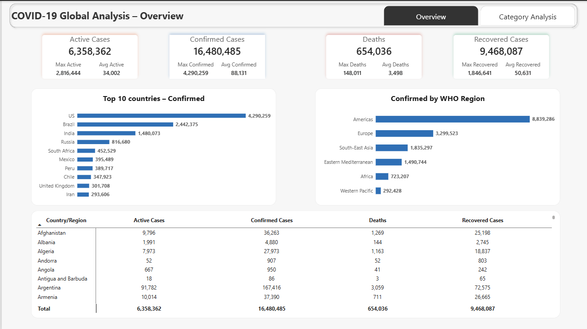
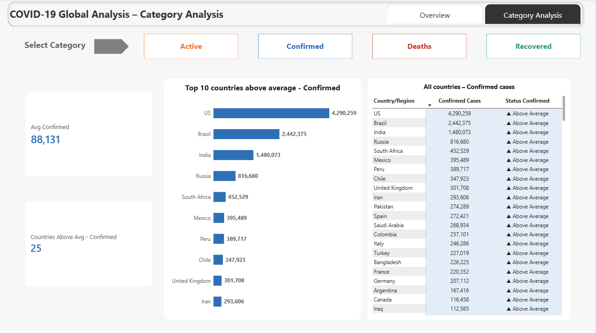

<div align="center">


# ✦ COVID-19 Global Analysis ✦

**Junior Data Analyst Project | Python · Excel · Power BI**

*Which countries carry the weight of the pandemic? Finding the story behind the numbers.*


</div>

* * *

<div align="center">

## ✦ THE QUESTION ✦

</div>

Using a snapshot of **187 countries (27 July 2020)**, the project answers two questions:

1. **Overall statistics:** total, maximum and average for *Active*, *Confirmed*, *Deaths* and *Recovered*.
2. **Countries above average:** which countries sit above the average in each category?

* * *

<div align="center">

## ✦ KEY FINDINGS ✦

| Category | Average per country | Countries above average | Share of world total they hold |
|:---:|:---:|:---:|:---:|
| 🟠 Active | 34,002 | 24 (12.8%) | 89.3% |
| 🔵 Confirmed | 88,131 | 25 (13.4%) | 85.6% |
| 🔴 Deaths | 3,498 | 26 (13.9%) | 91.8% |
| 🟢 Recovered | 50,631 | 28 (15.0%) | 88.5% |

</div>

- **About one country in seven carries 86–92% of every category.**
- The **US** leads Active, Confirmed and Deaths; **Brazil** leads Recovered.
- The **Americas** and **Europe** hold 73.7% of confirmed cases (8.84M and 3.30M of 16.48M).
- **11 countries** are above average in all four categories.
- Data caveats: counts are not adjusted for population, some countries report zero or almost no recoveries (so their Active count is overstated), and it is a single-day snapshot.

* * *

<div align="center">

## ✦ DASHBOARD ✦

</div>




* * *

<div align="center">

## ✦ PROJECT UNIVERSE ✦

</div>

```
covid-19-analysis/
├── data/
│   └── covid_clean.xlsx                    # cleaned dataset (187 countries)
├── notebooks/
│   └── covid_analysis.ipynb                # Python: cleaning + analysis
├── powerbi/
│   └── Covid_19_Report.pbix                # Power BI dashboard (2 pages)
├── reports/
│   ├── COVID-19_Data_Analysis_Report.pptx  # findings & recommendations
│   └── COVID-19_Data_Analysis_Report.pdf
└── images/                                 # dashboard screenshots
```

* * *

<div align="center">

## ✦ HOW IT WAS BUILT ✦

</div>

| Step | What happened |
|:---|:---|
| ✦ **Load** | Read the `country_wise_latest` sheet: 187 countries, one row per country |
| ✦ **Clean** | Dropped two stray export columns; validated: no missing values, duplicates or negatives |
| ✦ **Prepare** | Added an `Above_Avg` flag per category and exported the clean file to Power BI |
| ✦ **Visualise** | Two-page Power BI report: *Overview* (KPI cards, top 10, WHO regions) and *Category Analysis* (button-driven) |
| ✦ **Report** | Slide deck with 4 insights and 9 recommendations |

**Run it yourself**

```bash
pip install pandas openpyxl
jupyter notebook notebooks/covid_analysis.ipynb
```

Open `powerbi/Covid_19_Report.pbix` with [Power BI Desktop](https://powerbi.microsoft.com/desktop/).

* * *

<div align="center">

## ✦ A LITTLE CURIOSITY GOES A LONG WAY ✦

**One insight at a time.**

[](https://www.linkedin.com/)

*Back to my [little universe](https://github.com/hagernaser622) 🪐*

</div>
